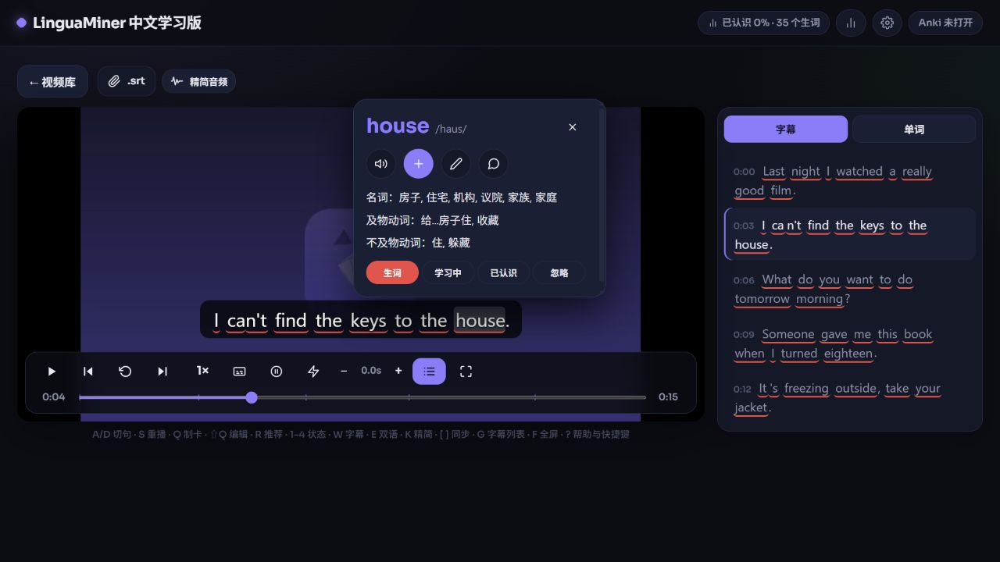

# LinguaMiner — Chinese Learning Edition

Learn English with local videos, interactive subtitles, and offline English–Chinese lookup.

A community edition of [LinguaMiner](https://github.com/thecopybookhare-cmd/lingua-miner), based on upstream v1.34.0. It retains the original architecture, learning tools, and MIT license.

## Features

- Simplified Chinese interface, with English as the learning language.
- Automatically extracts embedded English text subtitles from MKV/MP4 files. Original subtitles take priority.
- Supports external SRT subtitles and offline faster-whisper transcription when English subtitles are unavailable.
- Hover over words for spelling, dictionary phonetics, and multiple Chinese meanings. Pronunciation, word status, editing, and flashcard tools remain available.
- Includes setup for the free ECDICT dictionary and an offline English–Chinese sentence translation model.
- Fixes misleading “task lost” messages after failed large uploads and subtitle clipping after seeking in narrow windows.

## Install and use · Windows

1. Download the source ZIP from [Releases](https://github.com/nsq31415926/lingua-miner-zh/releases/latest) and fully extract it, preferably to a spacious D/E drive folder.
2. Double-click **install.bat**. The first installation downloads Python, FFmpeg, dependencies, dictionaries, and models.
3. Double-click **run.bat**, or open **LinguaMiner 中文学习版** from the Start menu.
4. Import a video. Embedded English text subtitles load automatically; otherwise choose **导入字幕** (Import subtitles) or **识别字幕** (Transcribe, default: small).
5. Hover over subtitle words for Chinese meanings; click to access the existing learning tools.

Allow at least **10 GB**, plus space for videos, imported copies, and temporary uploads. Data stays in `data`; runtime files and the virtual environment use `.runtime` and `.venv` beside the application. Some Windows/browser caches may still use the system drive.

## Practical notes

- Initial setup requires internet access. Local playback, dictionaries, sentence translation, and transcription with downloaded models then work offline.
- Image subtitles and burned-in subtitles cannot be extracted as text. Use SRT or transcription instead; Whisper accuracy varies with audio quality.
- Keep the server window open during use. Unfinished tasks do not survive a server restart; completed imports remain saved.
- Anki export requires Anki and AnkiConnect (`2055492159`). They are optional for playback and lookup.
- Before updating, back up `data`, close the server, replace application files, and rerun **install.bat**, keeping `data`. Existing installations can use `LINGUAMINER_DIR`; do not overwrite this edition with upstream updates.
- This edition has been tested on Windows. Other platforms have not received full installation testing. Videos, personal records, and downloaded models are not bundled with the source.

## Credits and license

Original project: [LinguaMiner](https://github.com/thecopybookhare-cmd/lingua-miner). Original copyright and [MIT license](LICENSE) are preserved.

[Original README](README.upstream.md) · [Third-party resources](THIRD_PARTY.md) · [Changes and validation](docs/zh-release-notes.md) · [Report an issue](https://github.com/nsq31415926/lingua-miner-zh/issues)

---

# LinguaMiner 中文学习版

用本地英语视频学习英语：互动字幕、悬停查词、离线中文释义。

本版基于 [LinguaMiner](https://github.com/thecopybookhare-cmd/lingua-miner) v1.34.0，属于社区修改版，保留原项目架构、学习功能及 MIT 许可。

## 主要功能

- 简体中文界面，默认学习英语。
- 自动提取 MKV/MP4 内置英文文本字幕，优先使用原字幕。
- 无英文字幕时，可导入外挂 SRT，或使用 faster-whisper 离线识别。
- 悬停显示英文单词、词典音标和中文多义释义，保留发音、单词状态、编辑及制卡功能。
- 配置免费 ECDICT 英汉词典和离线英汉句子翻译模型。
- 修复大视频上传失败误报“任务丢失”，以及窄窗口拖动进度后字幕被遮挡的问题。

## 安装与使用 · Windows

1. 从[发布页](https://github.com/nsq31415926/lingua-miner-zh/releases/latest)下载源码 ZIP，完整解压到空间充足的目录，建议放在 D/E 盘。
2. 双击 **install.bat**，等待首次下载 Python、FFmpeg、依赖、词典和模型。
3. 双击 **run.bat**，或在开始菜单打开 **LinguaMiner 中文学习版**。
4. 导入视频：内置英文文本字幕会自动加载；否则选择 **导入字幕** 或 **识别字幕**，识别默认使用 small 模型。
5. 鼠标停在字幕单词上查看中文释义，点击可使用原有学习功能。

建议预留至少 **10 GB**，另加视频、导入副本和上传临时文件所需空间。数据保存在程序旁的 `data`，运行环境放在 `.runtime` 和 `.venv`；部分 Windows、浏览器缓存仍可能使用系统盘。

## 使用须知

- 首次安装需要联网；完成后，本地播放、词典、句子翻译及已下载模型的字幕识别可离线运行。
- 图片字幕和画面烧录字幕无法直接提取为文本，可用外挂 SRT 或语音识别；Whisper 准确度受音频质量影响。
- 使用时保持服务窗口开启；未完成任务无法跨重启恢复，已完成导入会保留。
- 导出 Anki 卡片需安装 Anki 和 AnkiConnect（`2055492159`），看视频和查词不需要它们。
- 更新前备份 `data` 并关闭服务，替换程序文件后重新运行 **install.bat**，保留 `data`；已有安装可用 `LINGUAMINER_DIR` 指定数据目录，请勿用上游更新覆盖本版。
- 本版已在 Windows 上验证，其他平台尚未完整测试；源码包不包含电影、私人记录或下载模型。

## 来源与许可

原项目：[LinguaMiner](https://github.com/thecopybookhare-cmd/lingua-miner)，完整保留原作者版权声明及 [MIT 许可](LICENSE)。

[原版介绍](README.upstream.md) · [第三方资源](THIRD_PARTY.md) · [修改与验证记录](docs/zh-release-notes.md) · [反馈问题](https://github.com/nsq31415926/lingua-miner-zh/issues)
